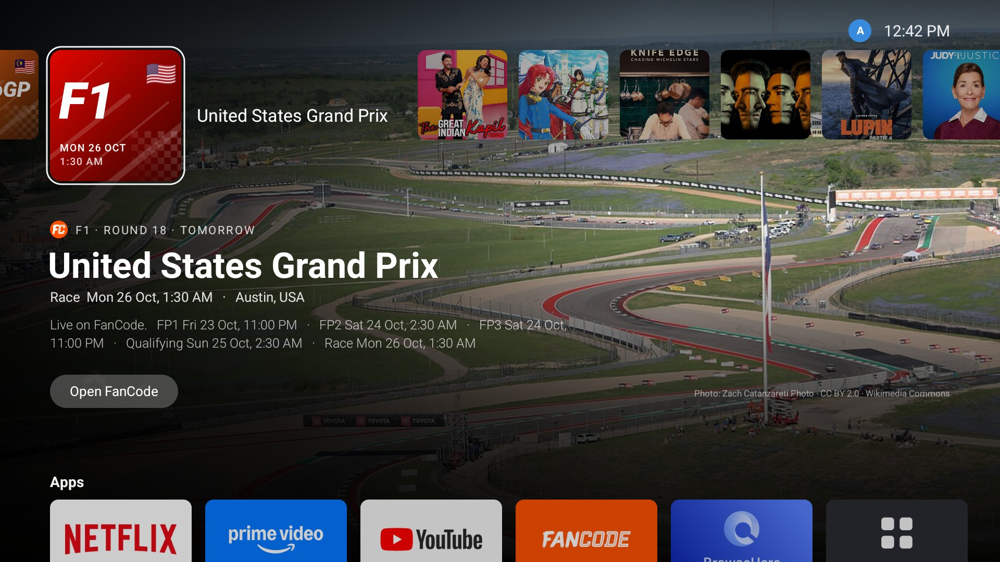
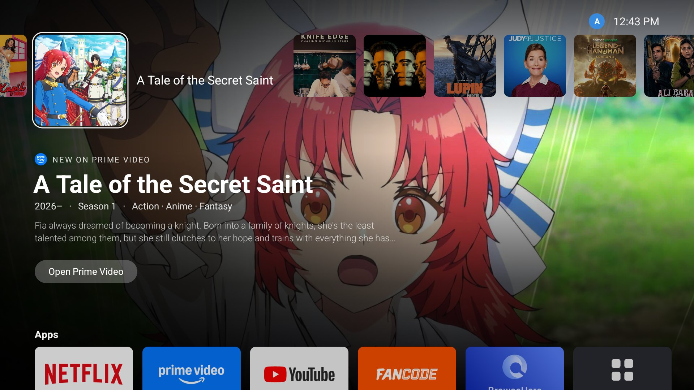
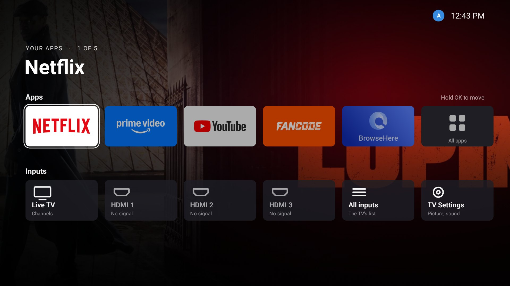
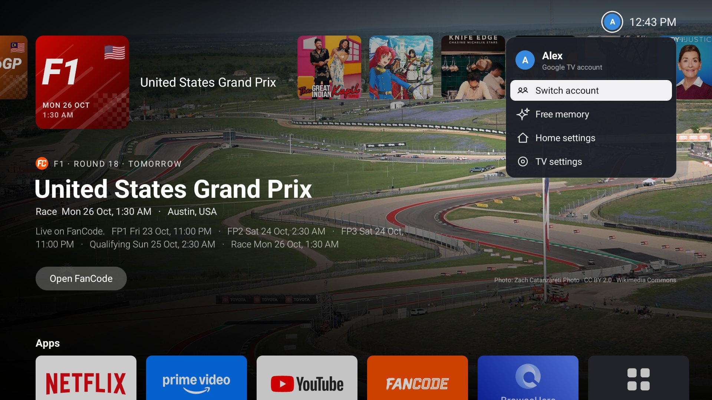
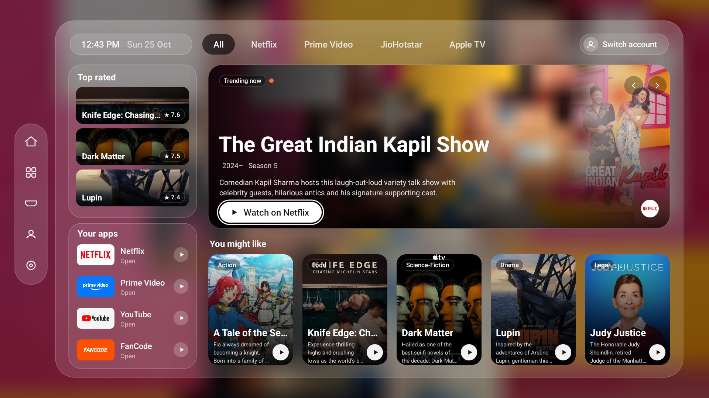
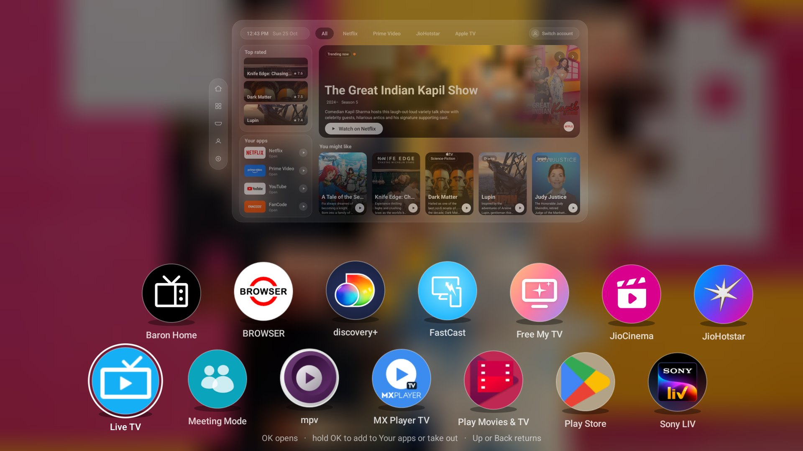

# ps5UI & visionUI

Two home screens for Google TV and Android TV: **ps5UI**, in the manner of the PS5's home screen, and **visionUI**,
in the manner of visionOS. One small app, no Google services, no API keys, drawn by hand on a single canvas so it
stays smooth on a 2 GB TV.

## Install: the tested way (Free My TV, then ps5UI)

> **Tested on one TV: an Acer Google TV, model R4G (Android 14, 2 GB).** The tested way is this one: **Free My TV
> first, in safe mode, then ps5UI**, both from the [`tested`](tested) folder. The one-app version further down
> ([ps5UI 1.1](#the-one-app-way-ps5ui-11-untested)) is **untested**.

### Important: why Free My TV runs in safe mode (start loops)

Free My TV normally becomes the TV's home screen by turning Google TV's own home screen off. **On some Google TVs that
stops the TV from starting: it loops at the logo, again and again.** Free My TV's own README reports it on a Kalley
43G200 (it came back only with a USB reflash) and a Huawei TV (only a factory reset), and it now refuses to switch on
those two.

The Acer R4G is the same kind of TV. At every start, Acer's TV Settings app turns about 60 apps back on, Google's
setup app among them, but not Google TV's home. With Google TV's home off, that setup app takes the Home button and
the TV loops at start, and ADB can't stop Acer's start-up job. **The public Free My TV doesn't know about the Acer R4G
yet**: its switch would turn Google TV's home off there.

So the Free My TV in [`tested`](tested) has a **safe mode** for this TV: **Google TV's home and its setup app are
never turned off.** Google TV's home stays the TV's real home underneath, and Free My TV catches the remote's Home
key instead (an accessibility service) and opens ps5UI. Whatever the TV turns back on at start, it still starts.

- **On an Acer R4G: use this Free My TV, never the public one.**
- **On any other TV**, the safe mode doesn't switch on: this Free My TV then switches like the public one. Check
  [Free My TV's README](https://github.com/simbasjungles/free-my-tv) for your TV first, or use ps5UI 1.1 below, which
  never turns anything off.

### Steps

You need a computer on the same Wi-Fi as the TV, with [adb](https://developer.android.com/tools/releases/platform-tools).

1. **On the TV, turn on USB debugging:** Settings > System > About, press OK on **Android TV OS build** seven times,
   then Settings > System > Developer options > **USB debugging** on. Note the TV's IP address (Settings > Network &
   Internet > your Wi-Fi).
2. **Download** [`tested/FreeMyTV-safe-mode.apk`](tested/FreeMyTV-safe-mode.apk) and
   [`tested/ps5UI-1.0.apk`](tested/ps5UI-1.0.apk) to the computer.
3. **Install Free My TV first:**
   ```bash
   adb connect <TV IP>:5555
   adb install -r FreeMyTV-safe-mode.apk
   ```
   On the TV's **Allow USB debugging?**, tick **Always allow** and pick **Allow**. If the install seems stuck, look at
   the TV: Google Play Protect may say *Risky app blocked*; pick *More details* > *Install anyway*.
4. **Turn on Free My TV mode:** on the TV, open Free My TV, then **Home Screen > Free My TV**. Allow USB debugging
   again if the TV asks (this time it's Free My TV itself). It turns off Ambient mode and Play Games (the TV turns them
   back on at start, and Free My TV turns them off again) and becomes the screensaver. Google TV's home stays on.
5. **Then install ps5UI:**
   ```bash
   adb install -r ps5UI-1.0.apk
   ```
6. **Pick it:** in Free My TV, **Home Settings > Home Button > ps5UI** (or visionUI).

That's it. The remote's Home button opens ps5UI, from any app. After a start or on waking, Google TV's own *Choose an
account* screen comes first, then ps5UI. The corner's account name and Free memory work through Free My TV, and
holding Home for a moment opens Free My TV's Control Center.

**Undo:** Free My TV > Home Screen > **Original** puts everything back; then uninstall both in Settings > Apps.

Notes:
- This Free My TV is the one on the tested TV, with Google Assistant left on. Its weather and sunset are set for
  Bengaluru and its picks for India (it's built that way; rebuild from source to change them). Its changes to Free
  My TV are in [`tested/free-my-tv-safe-mode.patch`](tested/free-my-tv-safe-mode.patch), against Free My TV's commit
  `f2d984c`, under Free My TV's MIT licence (see [LICENSE](LICENSE)).
- ps5UI 1.0 and 1.1 are signed with different keys: to switch from one to the other, uninstall ps5UI first.



## ps5UI

| | |
|---|---|
|  |  |
| New episodes on your apps, the focused one's art filling the screen | Your apps and inputs, with the app's newest show drifting behind |
|  | |
| The account corner: Switch account, Free memory, Home settings, TV settings | |

- **The top row:** this week's new episodes on Netflix, Prime Video, JioHotstar, Apple TV and the rest (from
  [TVmaze](https://www.tvmaze.com/api)). The focused one is bigger and named beside it, with its details and an Open
  button over its art.
- **F1 and MotoGP:** race weekends in the next two weeks lead the row. It opens on the next race; later ones peek in
  from the left. Each race shows its time in your time zone, the whole weekend's sessions, and a real photo of the
  track from Wikimedia Commons, credited on screen.
- **Apps and inputs:** press Down. Your apps (hold OK to move one) end with All apps (hold OK to add or remove). The
  inputs row has Live TV, HDMI with a dot when a device is connected, and TV Settings. Behind them, the focused app's
  newest show (or its colours, as soft moving light) drifts slowly. The focused tile gets a sheen.
- **The account corner:** press Up from the top row to reach the picture by the clock.
- **Sounds:** soft UI clicks, made from scratch by [`tools/make-sounds.py`](tools/make-sounds.py). They follow the
  TV's System sounds setting.
- **Built for a slow TV:** each backdrop is pre-blended with its shading into one picture in the background, tiles
  are drawn as rounded shapes instead of clipped, and along a row the backdrop follows a beat after focus, as on the
  PS5. On the 2 GB test TV, frames take 11–17 ms, with 0–5% slow frames.

## visionUI

| | |
|---|---|
|  |  |
| A frosted glass window over the trending show | Down past the window: it steps back and your apps float up |

- A glass window with a sidebar, service filters (All, Netflix, Prime Video, JioHotstar, Apple TV), Top rated, Your
  apps, a Trending now hero that turns every few seconds, and You might like.
- The apps view: every app floats up as a round icon, one after another, then they bob gently. Your apps come first.

## The one-app way: ps5UI 1.1 (untested)

> **Not tried on a TV yet.** ps5UI 1.1 has Free My TV's safe mode built in (the Home button, the account picker and
> Free memory), so it's one app and nothing else to install, and it never turns anything on the TV off. Don't use
> it together with the tested way: with Free My TV's Home button on, ps5UI 1.1 leaves Home to Free My TV.

1. Get [`ps5UI.apk`](ps5UI.apk) onto the TV, either way:
   - **From a computer:** USB debugging on (as in the [tested way](#steps)), then
     `adb connect <TV IP>:5555` and `adb install -r ps5UI.apk`.
   - **On the TV:** install the Downloader app (by AFTVnews) from the Play Store, allow it to install
     unknown apps when it asks, and open this address in it:
     `https://github.com/Anupam-Singh-Tomar/ps5ui-visionui/raw/main/ps5UI.apk`
2. Open **ps5UI** (or **visionUI**) from the TV's apps. The first time, **Home button** opens: pick ps5UI or visionUI.
3. The TV asks **Allow USB debugging?**: tick **Always allow** and pick **Allow**. That's it: the remote's Home button
   now opens the one you picked, from any app.

Android 8 or newer. Updates: install the new `ps5UI.apk` over the old one; your app order is kept.

### How 1.1's Home button works

Google TV doesn't let another app be its home screen without turning Google TV's own off, and on some TVs (the Acer
and Kalley ones, at least) that makes the TV get stuck at start. So ps5UI does it the safe way, as Free My TV's safe
mode does: **nothing on the TV is turned off**. Google TV's home stays underneath, and ps5UI's Home button (an
accessibility service, *ps5UI Home button*) opens ps5UI instead:

- **Home** opens ps5UI or visionUI, from any app.
- When Google TV's home comes up anyway (after a start, on waking, backing out of an app), ps5UI opens over it. You
  may see Google TV's home for a moment first.
- When the TV starts or wakes, Google TV's own **Choose an account** screen comes first (turn it off in Home
  settings). On that screen only, ps5UI keeps the name on the account you pick, never the email, for the corner.
  Google doesn't let other apps read account photos, so the corner shows an initial.
- **Free memory** (the corner) closes the apps Android keeps waiting in the background, through the TV's own ADB, and
  shows how much it freed.

To change it later: ps5UI's corner (Up from the top row, by the clock) > **Home settings**. Pick **Google TV** to
give Home back to Google TV. To remove everything, uninstall ps5UI.

**Turning on USB debugging** (needed once, for the Home button and Free memory): Settings > System > About, press OK
on **Android TV OS build** seven times; then Settings > System > Developer options > **USB debugging**. If you'd rather
not, turn on *ps5UI Home button* in Settings > System > Accessibility instead (Free memory then won't work).

Already use Free My TV? Then it handles the Home key itself and ps5UI stays out of its way: pick ps5UI in Free My TV >
Home Settings > Home Button.

### Building it yourself

You need a JDK 17+ and the Android SDK (`build-tools;34.0.0`, `platforms;android-34`). No Gradle.

```bash
./build.sh
adb install -r out/ps5UI.apk
```

`build.sh` makes `out/ps5UI.apk`, signed with a key of its own (`ps5ui.keystore`, made on the first build). Keep it:
updates must be signed with the same key. (An APK you build won't install over the one here, which has another key:
uninstall that one first.)

## Data

No keys and no accounts. Everything is cached on the TV.

- [TVmaze](https://www.tvmaze.com/api): new episodes, show details and art.
- [Jolpica F1](https://github.com/jolpica/jolpica-f1): the F1 calendar.
- MotoGP's public results API: the MotoGP calendar.
- [Wikimedia Commons](https://commons.wikimedia.org): track photos, each shown with its author and licence.

## Credits

- **[Free My TV](https://github.com/simbasjungles/free-my-tv)** ([freemytv.io](https://freemytv.io)), MIT licensed,
  by the Free My TV contributors. ps5UI's Home button, account picker and Free memory are Free My TV's safe mode,
  built in: its ADB client ([`Adb.java`](src/io/freemytv/cinema/Adb.java)) and its way of handling Google TV's
  home screen. It also shaped how this app is built: one hand-drawn canvas, no Gradle, no libraries. The package
  name (`io.freemytv.cinema`) keeps that link.
- Show data and art: TVmaze and the shows' owners. Track photos: their authors on Wikimedia Commons, under the
  licence shown with each.

Not affiliated with Sony Interactive Entertainment, Apple, Google, or any streaming service. PlayStation, PS5 and
visionOS are trademarks of their owners. ps5UI and visionUI only borrow a style.

## License

[MIT](LICENSE)
